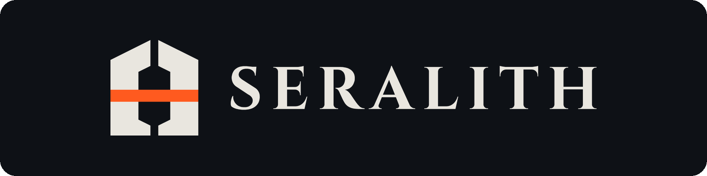

  

<h3 align="center">Build in parallel. Ship with proof.</h3>

  Seralith is the development workbench for teams that let humans and coding agents
  work side by side, and need to prove exactly who changed what.

---

Coding agents now write a large share of the world's software. The organizations
that build the most consequential systems — defense programs, government
contractors, critical infrastructure — are now required to know which code a
machine wrote, which tools produced it, and who reviewed the parts that matter.

**Seralith records that at the moment code is written, and proves it before code ships.**

| | |
| --- | --- |
| **Parallel workspaces** | Every task runs in an isolated workspace. Run many agents and your own editor at once. |
| **Observed attribution** | Authorship is measured, not self-reported, down to the line. |
| **Signed provenance** | Every commit carries an in-toto attestation signed with Ed25519. |
| **Policy gates** | Role-bound human approval for agent changes to security-critical code, enforced in CI. |
| **Evidence packages** | Assessor-ready evidence mapped to DoWI 8430.01, NIST SP 800-218, NIST SP 800-171, and the EU Cyber Resilience Act. |

Seralith never sits between developers and their model providers and never handles
their credentials. It runs fully offline and is built for air-gapped environments.

### Contact

| | |
| --- | --- |
| Website | [seralith.com](https://seralith.com) |
| Pilots and procurement | [sales@seralith.com](mailto:sales@seralith.com) |
| Security reports | [security@seralith.com](mailto:security@seralith.com) |
| Everything else | [hello@seralith.com](mailto:hello@seralith.com) |

© 2026 Seralith
